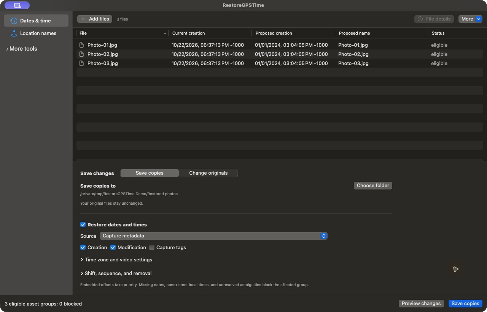
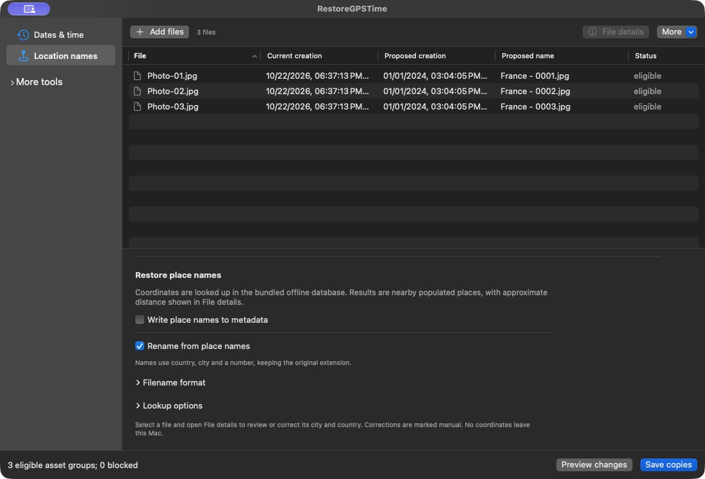

# RestoreGPSTime

Original native macOS utility for restoring photo/video file dates and place names. Separate Apple Silicon and Intel builds target macOS 13+. Version 0.1.0 is available as self-signed preview releases.

## Downloads

| Mac | Release |
| --- | --- |
| Apple Silicon (arm64) | [0.1.0 Apple Silicon — self-signed preview](https://github.com/Delitants/restoregpstime-macos/releases/tag/v0.1.0-selfsigned-arm64) |
| Intel (x86_64) | [0.1.0 Intel — self-signed preview](https://github.com/Delitants/restoregpstime-macos/releases/tag/v0.1.0-selfsigned-x86_64) |

These builds are **self-signed and unnotarized**. macOS may block downloaded copies or show an unidentified-developer warning. Each release includes its ZIP, public certificate, checksums, installation notes and verification details. Apple Silicon was tested natively; Intel was tested through Rosetta on Apple Silicon. Physical Intel and macOS 13 host testing remain pending. See [installation](docs/INSTALL.md).

## Screenshots

**Date restoration**

Preview creation and modification dates from capture metadata before saving copies.



**Location names and batch renaming**

Look up cities and countries offline, then preview custom filenames with incremental numbers.



Captured from RestoreGPSTime 0.1.0 using demo files with generated metadata.

## Features

Restore creation and modification dates from qualified EXIF/XMP/QuickTime capture metadata, explicit date sources, reference files, filenames, shifts or sequences. Resolve existing GPS coordinates to approximate city/country names offline, review distance and alternatives, correct a place manually, write qualified comments/structured metadata or rename files with collision-safe numbering.

The app supports batch preview, Save Copies and recoverable in-place processing. Frozen plans retain selected settings, identities, date provenance, names and dependencies. It streams file hashing, verifies stored image/video payloads, rejects conflicting edits and retains partial reports and recovery evidence. Workflows, Services and native droplets import files for review before Apply. Finder attributes, scoped system Trash and Finder visibility are available as separate actions.

Generated integration fixtures cover JPEG, baseline HEIC, TIFF, PNG, WebP, AVIF, MOV and MP4. Post-signing checks on a genuine Nikon COOLPIX P6000 NRW sample verified capture/GPS date restoration, offline place lookup, batch numbering, in-place renaming and undo while preserving the RAW bytes and file attributes. Embedded-write support is qualified by operation and layout; this NRW test does not qualify embedded RAW metadata writing. Genuine HDR/depth/auxiliary HEIF, Live Photos, additional RAW families and video formats, large real video and filesystem/host matrices still need acceptance evidence. See [known limits](docs/KNOWN-LIMITS.md).

The app bundles ExifTool 13.59, Perl 5.44.0 and an offline GeoNames-derived database. It makes no outbound network requests and requires no separate Perl/Homebrew installation. Reports stay local and omit coordinates by default. Dependency source hashes/licenses are recorded in `Dependencies/` and `ThirdParty/`.

## Build and test

Use Xcode with Swift 5.9 or newer, Python 3.12+, the system C compiler and make. Build scripts download official pinned dependency archives, verify their SHA-256 values and retain build receipts. Existing candidate outputs are never overwritten.

```sh
Scripts/build-app.sh --arch arm64 --configuration debug --output work/test-bundles/FRESH_ARM64
Scripts/test.sh
Scripts/build-app.sh --arch x86_64 --configuration release --output work/test-bundles/FRESH_INTEL
python3 -m unittest discover -s Tests/ReleaseGateTests -v
```

Choose a matching fixture bundle with `RESTOREGPSTIME_TEST_APP` for Core tests and `RESTOREGPSTIME_TEST_APP_BUNDLE` for app backend tests. Intel tests must execute under a matching process; SwiftPM discovery from an ARM process is not native Intel proof. Rosetta is labeled separately. Generated test files belong only in disposable local workspaces. The system Trash test is opt-in.

The developer-only `RestoreGPSTimeQA` executable records actual host identity, bundled runtime/dependency hashes and fixture identities. `Scripts/qualify.sh --app PATH --fixture-manifest PATH --evidence-dir FRESH_PATH --host-label LABEL` writes explicit pass/fail/missing gates and returns nonzero for incomplete acceptance. It is not included in the user app. The manual self-hosted workflow performs no artifact/private-media upload.

## Acceptance and release

[Installation](docs/INSTALL.md), [recovery](docs/RECOVERY.md), [release procedure](docs/RELEASE.md), [evidence contract](docs/acceptance/EVIDENCE.md), [format matrix](docs/acceptance/format-matrix.json), [host matrix](docs/acceptance/host-matrix.json), [31 reference actions](docs/acceptance/reference-actions.csv), and [Finder Tools](docs/acceptance/reference-tools.csv).

The self-signed 0.1.0 preview tags both point to source commit `927cbd0a2f80cae5ae564ed79ea07757fc251c0f`. Release assets retain that build identity; subsequent documentation changes do not change their binaries. Their code signatures use the locally generated RestoreGPSTime Self-Signed (Delitants) certificate, not an Apple- or GitHub-issued identity.

Future notarized stable publication to `Delitants/restoregpstime-macos` requires both architecture sets at one reviewed source SHA, native ARM/Intel and macOS 13 acceptance, genuine-format/volume evidence, native UI/OS integration, the Instruments responsiveness trace, relocated/offline/quarantine checks, public-content audit, Developer ID signing and notarization. The stable-release checker and publisher enforce those gates. Self-signed preview publication is documented separately in the release procedure.

[Approved specification](docs/superpowers/specs/2026-10-21-restoregpstime-design.md), [implementation plan](docs/superpowers/plans/2026-10-21-restoregpstime-implementation.md), and [reference behavior](docs/REFERENCE.md). Original code uses the MIT license; dependencies retain their separate licenses. No reference-app binary/artwork or personal media is distributed.
