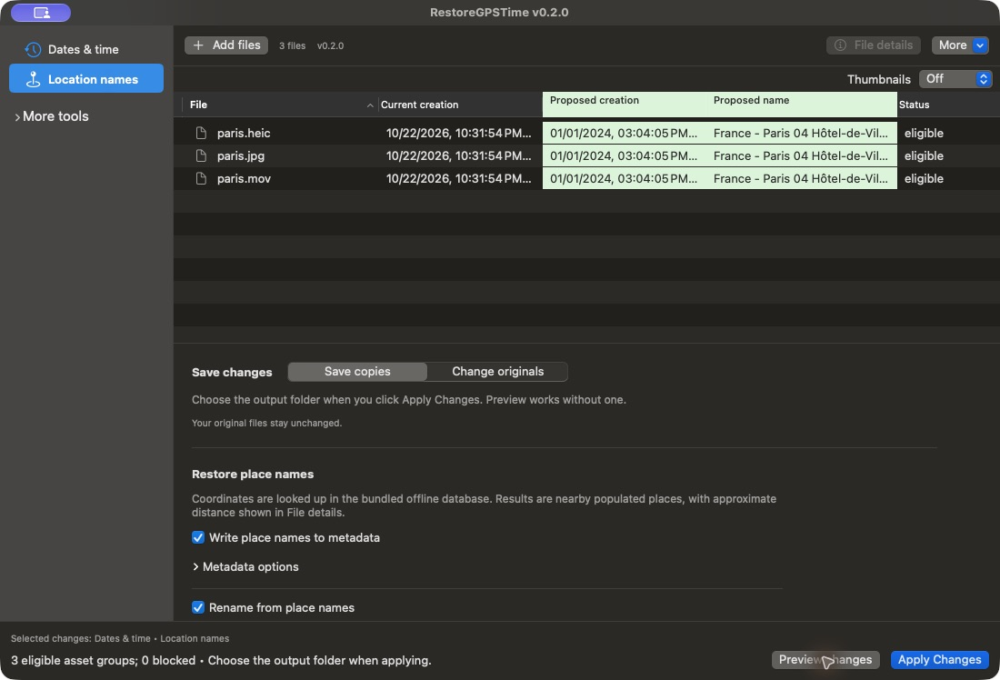
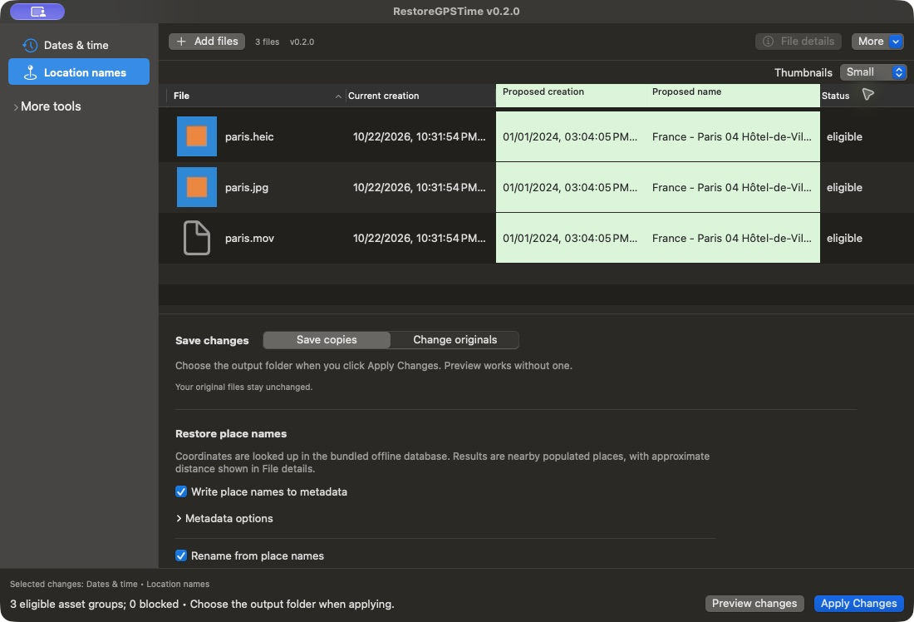

# RestoreGPSTime

Restore photo and video dates from metadata, recover place names from GPS, and rename files in batches. Works offline on macOS 13+.

## Download

**Version 0.2.0:** [Apple Silicon](https://github.com/Delitants/restoregpstime-macos/releases/tag/v0.2.0-selfsigned-arm64) · [Intel](https://github.com/Delitants/restoregpstime-macos/releases/tag/v0.2.0-selfsigned-x86_64)

Self-signed and unnotarized. If macOS blocks the first launch, use **System Settings → Privacy & Security → Open Anyway**.

## Features

- Restore creation and modification dates from EXIF/GPS metadata.
- Look up city and country names offline; write names or rename files with numbering.
- Batch processing for photos, videos and RAW files, including Nikon NEF/NRW.
- Save copies or modify originals, with metadata-only or full backups and undo.
- Optional thumbnails and remembered settings.

## Use

Add files, preview each selected tab, then click **Apply Changes**. Choose the copies folder when applying.

Metadata-only undo requires the processed files to remain unchanged. [Help and installation](docs/INSTALL.md).

## Screenshots

[MIT license](LICENSE)
